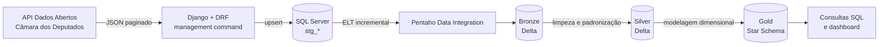
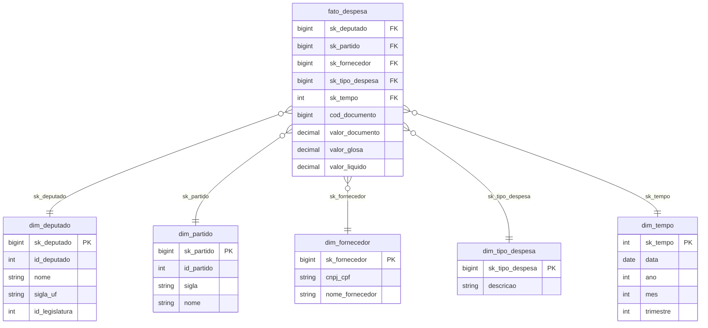

# Pipeline de Dados – Câmara dos Deputados

Projeto de engenharia de dados ponta a ponta: extração de dados abertos da Câmara dos Deputados via API pública, ingestão no **SQL Server** com **Django REST Framework**, ELT com **Pentaho Data Integration (PDI)** e construção de uma **arquitetura medalhão (Bronze/Silver/Gold)** com **Star Schema** no **Databricks**.

> **Status:** em desenvolvimento. Os nomes de endpoints, campos e tabelas descritos aqui são a proposta inicial e devem ser validados na [documentação oficial da API](https://dadosabertos.camara.leg.br/swagger/api.html).

---

## Sumário

- [Objetivo](#objetivo)
- [Arquitetura](#arquitetura)
- [Stack](#stack)
- [Fonte de dados](#fonte-de-dados)
- [Modelo de dados](#modelo-de-dados)
- [Estrutura do repositório](#estrutura-do-repositório)
- [Pré-requisitos](#pré-requisitos)
- [Como executar](#como-executar)
- [Etapas do projeto](#etapas-do-projeto)
- [Qualidade de dados](#qualidade-de-dados)
- [CI/CD](#cicd)
- [Consultas analíticas](#consultas-analíticas)
- [Autor](#autor)

---

## Objetivo

Demonstrar, em um cenário reproduzível, as práticas centrais de um pipeline de dados moderno:

- Consumo de API paginada com tratamento de falhas e cargas idempotentes.
- Camada relacional de staging em SQL Server.
- ELT com carga incremental, controle de execução e logs no PDI.
- Catalogação com Unity Catalog e arquitetura medalhão em Delta Lake.
- Modelagem dimensional (Star Schema) para análise.
- Versionamento e automação com GitHub e GitHub Actions.

## Arquitetura



| Camada | Tecnologia | Função |
|---|---|---|
| Fonte | API Câmara dos Deputados | Deputados, partidos e despesas da cota parlamentar |
| Ingestão | Django + DRF + `mssql-django` | Consome a API e grava no SQL Server |
| Staging | SQL Server | Dados brutos da origem (`stg_*`) |
| ELT | Pentaho Data Integration | Move e transforma dados do SQL Server para o Databricks |
| Bronze | Databricks (Delta Lake) | Dado cru + metadados de ingestão |
| Silver | Databricks (PySpark/SQL) | Tipagem, deduplicação, padronização, qualidade |
| Gold | Databricks (SQL) | Star Schema: fato e dimensões |

## Stack

- **Linguagens:** Python, SQL, PySpark
- **Backend de ingestão:** Django, Django REST Framework, `mssql-django`
- **Banco relacional:** Microsoft SQL Server (SSMS)
- **ELT:** Pentaho Data Integration 10.2 CE
- **Lakehouse:** Databricks Free Edition, Delta Lake, Unity Catalog
- **Versionamento e automação:** Git, GitHub, GitHub Actions
- **Testes:** pytest

## Fonte de dados

API pública **Dados Abertos da Câmara dos Deputados**, sem necessidade de chave de acesso.

- URL base: `https://dadosabertos.camara.leg.br/api/v2`

| Endpoint | Uso | Alimenta |
|---|---|---|
| `GET /deputados` | Lista de deputados | `stg_deputados` → `dim_deputado` |
| `GET /partidos` | Lista de partidos | `stg_partidos` → `dim_partido` |
| `GET /deputados/{id}/despesas` | Despesas da cota parlamentar (filtros de ano/mês, paginação) | `stg_despesas` → `fato_despesa`, `dim_fornecedor`, `dim_tipo_despesa` |

## Modelo de dados

### Staging (SQL Server)

`stg_deputados`, `stg_partidos` e `stg_despesas`, todas com a coluna `data_carga` para auditoria e controle de carga incremental.

### Gold (Star Schema)



## Estrutura do repositório

```text
.
├── django_api/        # Projeto Django/DRF (models, management command, testes)
├── pdi/               # Jobs (.kjb) e transformações (.ktr) do Pentaho
├── databricks/        # Notebooks/scripts de Bronze, Silver e Gold
├── sql/               # DDL do SQL Server e consultas analíticas
├── docs/              # Diagramas e documentação adicional
├── .github/workflows/ # Pipelines do GitHub Actions
├── .env.example       # Modelo de variáveis de ambiente (sem credenciais)
└── README.md
```

## Pré-requisitos

- Python 3.11+
- SQL Server e SQL Server Management Studio (SSMS)
- ODBC Driver 18 for SQL Server
- Pentaho Data Integration 10.2 CE
- Conta no Databricks Free Edition
- Git

## Como executar

### 1. Clonar e preparar o ambiente

```bash
git clone <url-do-repositorio>
cd <nome-do-repositorio>

python -m venv .venv
source .venv/bin/activate        # Windows: .venv\Scripts\activate
pip install -r django_api/requirements.txt
```

### 2. Configurar variáveis de ambiente

Copie o modelo e preencha com seus dados. **Nunca versione o arquivo `.env`.**

```bash
cp .env.example .env
```

```env
DB_NAME=camara_dw
DB_USER=
DB_PASSWORD=
DB_HOST=localhost
DB_PORT=1433
CAMARA_API_BASE_URL=https://dadosabertos.camara.leg.br/api/v2
```

### 3. Criar as tabelas de staging

```bash
cd django_api
python manage.py migrate
```

### 4. Ingerir dados da API no SQL Server

```bash
python manage.py carregar_camara --ano 2025
```

O comando pagina a API, aplica *retry* em caso de falha e faz *upsert* usando `cod_documento`, o que permite reexecutar sem duplicar dados.

### 5. Executar o ELT no PDI

1. Abra o Spoon e configure as conexões com o SQL Server e com o Databricks.
2. Execute o job principal em `pdi/` (carga incremental por ano/mês).
3. Confirme que os dados chegaram à camada Bronze.

### 6. Construir Silver e Gold no Databricks

Execute, em ordem, os notebooks/scripts de `databricks/`:

1. Criação do catálogo e dos schemas `bronze`, `silver` e `gold`.
2. Tratamento da Silver (tipagem, deduplicação, padronização, `MERGE`).
3. Construção das dimensões e da `fato_despesa` na Gold.

## Etapas do projeto

| # | Etapa | Entregáveis principais |
|---|---|---|
| 1 | **Fundação** | Escopo, diagrama de arquitetura, repositório, README, `.gitignore` |
| 2 | **Ingestão com Django/DRF** | Models, command de carga, upsert idempotente, logs, testes |
| 3 | **ELT com PDI** | Jobs e transformações versionados, carga incremental, controle de execução |
| 4 | **Bronze e Silver** | Unity Catalog, tabelas Delta, limpeza, padronização, checagens de qualidade |
| 5 | **Gold e fechamento** | Star Schema, consultas analíticas, GitHub Actions, lições aprendidas |

Cada etapa é documentada em um post no LinkedIn.

## Qualidade de dados

- **Bronze:** cópia fiel da origem, com `ingestion_ts` e identificação da fonte.
- **Silver:** tipagem explícita, remoção de duplicados por chave natural, padronização de CPF/CNPJ e tratamento de nulos.
- **Checagens:** unicidade de chaves, valores não negativos, integridade entre fato e dimensões e contagem de registros entre camadas.

## CI/CD

O workflow em `.github/workflows/` executa, a cada *pull request*:

- Lint do código Python.
- Testes automatizados com pytest.

## Consultas analíticas

Exemplos de perguntas que o modelo Gold responde:

- Quais são os maiores fornecedores por valor líquido?
- Qual o gasto total por partido e por UF?
- Como evolui a despesa por mês e por tipo de despesa?

```sql
SELECT p.sigla,
       SUM(f.valor_liquido) AS total_liquido
FROM gold.fato_despesa f
JOIN gold.dim_partido p ON p.sk_partido = f.sk_partido
GROUP BY p.sigla
ORDER BY total_liquido DESC;
```

## Autor

**Kallebe Almeida** – Engenheiro de Dados Júnior
[LinkedIn](https://linkedin.com/in/kallebson11)
